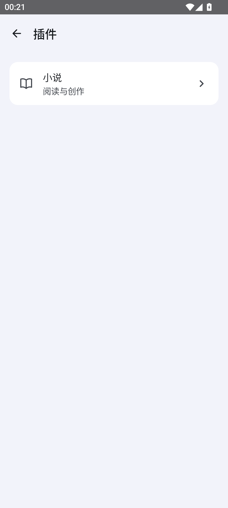
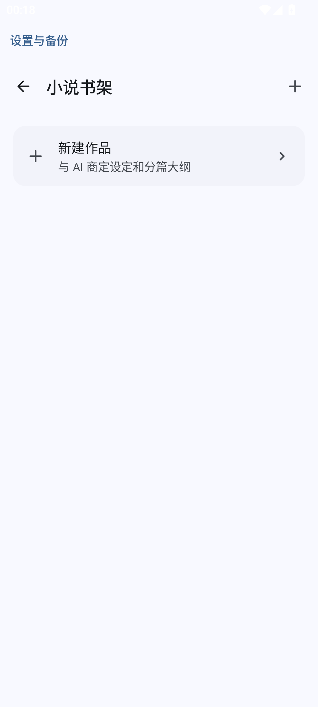
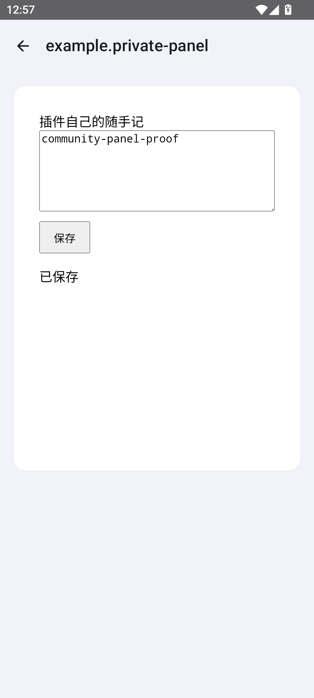

# 在 Memo 拓展版开发 GitHub 榜单日报

如果用户要看当天榜单、离线读上次日报，并能点开 GitHub 项目，208 可采用 **`activity/1` 插件入口 + 作者自己的 Android 伴生应用**。如果只需展示随插件打包的一份固定样报，离线网页面板就够用。

## 开发和试装从哪里开始

目标宿主为 Android 备忘录拓展版 **0.5.1-ext，versionCode 208**，包名 `com.gaoyixuan.memo.ext`，最低 Android 14。市场公开了 SDK、示例源码及已发布插件。**208 宿主 APK 未公开分发**；需要联调宿主入口时，与宿主维护者单独协调测试环境。开发者可先独立构建伴生 APK，并在自己的 Android 测试设备上验证列表、缓存和外链。[SDK](../sdk/README.md) · [伴生应用示例和构建步骤](../android/example-app/README.md) · [已发布的完整伴生插件](https://github.com/Ga0ga0z1/memo-plugin-market/releases/tag/novel-studio-v1)

| 需求 | 208 离线网页面板 `web-panel/1` | Android 伴生应用 `activity/1` |
| --- | --- | --- |
| 自定义列表和详情 | 可以，用一个 HTML 文件内联样式和脚本 | 可以，由自己的 Activity 绘制 |
| 联网拉取榜单或日报 | 宿主屏蔽页面网络请求 | 在伴生 APK 的清单声明 `android.permission.INTERNET`，由该应用请求数据 |
| 缓存日报 | 授权后可读写少量插件私有状态，每个值最多 2048 个 UTF-16 代码单元，单条端口请求最多 4096 个 UTF-8 字节。页面没有网络或 DOM 存储接口来同步日报 | 可按日期保存在应用自己的文件或数据库中，断网时展示最近一次成功同步的日期与内容 |
| 点击打开 GitHub | 宿主拦截页面导航，面板端口没有打开外链的操作 | 用户点击后可用 Android 的 `ACTION_VIEW` 打开选定的 GitHub HTTPS 链接 |

伴生入口在插件清单里声明空权限数组，宿主按包名、Activity 和证书核对后打开应用。网络与缓存属于伴生 APK 自己的能力。实现时可对照[插件协议](plugin-contract.md)和[离线面板示例](../sdk/examples/private-panel/)。

## 每天谁生成，模型费用由谁承担

**所有人看同一份日报时，建议每日统一生成一次。** 例如，作者在自己控制的仓库或服务中安排定时任务，获取榜单，生成带日期的日报并保留历史。伴生应用打开时同步，成功后保存到本机。这样即使用户整天没开 Memo，服务端也可以生成当天的内容；手机离线时只能读到此前成功缓存的版本。想在打开应用之前就把新日报下载到手机，还需伴生应用另行实现后台同步。

208 的插件协议没有为第三方插件提供每日后台执行入口。宿主提供 `memo.confirmed-action/1` 的 `ask` 动作，由用户逐次确认，使用该设备已配置的模型和密钥，费用归对应模型账户。此动作不向伴生应用交付密钥，也不适合作为公共日报的无人值守生成接口。只展示榜单、链接和原始描述时，可以先不调用模型。[模型动作与权限](plugin-contract.md)

**上线前由作者和项目负责人约定**：榜单来源和统计口径、每天的生成时间与时区、运行任务的仓库或账号、历史日报的发布位置，以及使用 AI 时的付费账户和预算。市场收录本身不包含运行账号、模型额度或调度服务。开发和界面联调可先使用固定日期的示例日报；讨论资源归属无需提供密钥。

## 签名、投稿和更新

作者用自己的发布者密钥签署 `.memoplugin`，另用自己的 Android 签名证书签署伴生 APK，并将该证书的 SHA-256 填入插件清单。作者在自己的 GitHub Release 发布带固定 tag 的文件，再提交市场审核。当前可通过 Issue 投稿，跨仓签名目录尚未上线。[投稿表单与审核流程](../CONTRIBUTING.md)

用户首次安装伴生 APK，在 Memo 中核对作者公钥、导入插件入口并启用。仅更新每日榜单时，应用同步内容即可。更新伴生程序时，用相同 Android 包名和兼容签名发布更高版本 APK，用户覆盖安装。入口包有变化时，沿用作者密钥、发布者 ID 和插件 ID，提高插件的 `versionCode`，用户导入新版并核对权限。[安装实例](https://github.com/Ga0ga0z1/memo-plugin-market/releases/tag/novel-studio-v1)

## 实际界面参考

以下是测试镜像截图。左图展示用户从宿主进入插件的位置，中图展示独立伴生页面，右图展示宿主内嵌面板。日报列表和详情的排版由插件作者设计。

| 宿主插件列表（207） | 小说工作室书架（从 207 打开） | 离线面板保存状态（208） |
| --- | --- | --- |
|  |  |  |
